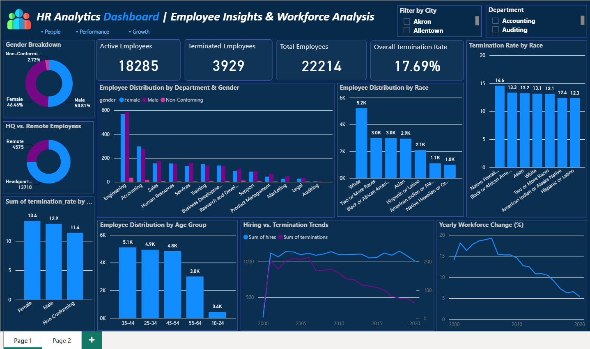
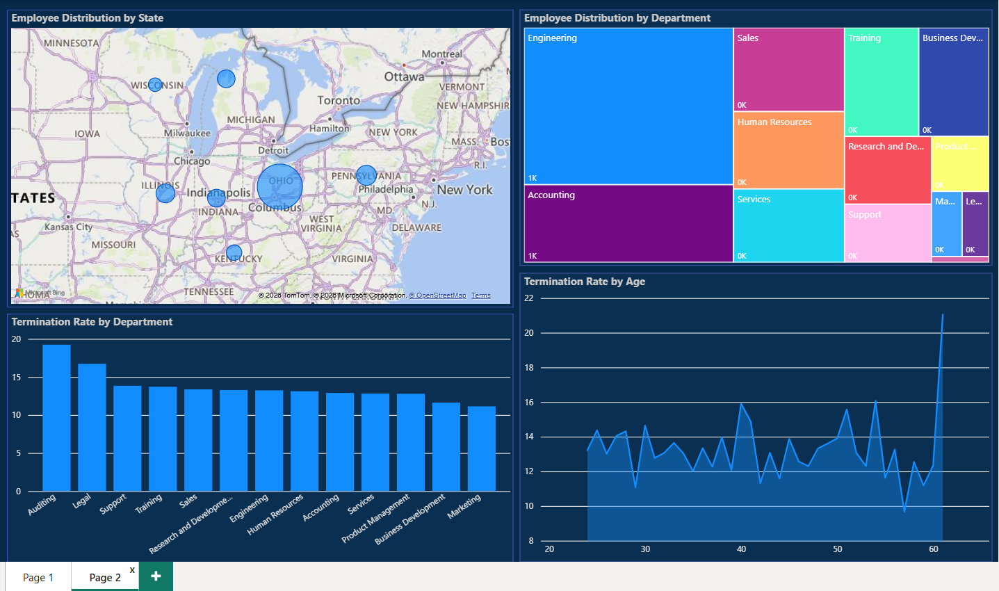

# HR Analytics Dashboard | Employee Insights & Workforce Analysis

An end-to-end data analytics project: raw HR data **cleaned and analyzed in MySQL**, then visualized in an interactive **Power BI** dashboard that answers key workforce questions on headcount, diversity, attrition and hiring trends.

---

## 📌 Table of Contents
- [Business Problem](#-business-problem)
- [Dataset](#-dataset)
- [Tools & Technologies](#-tools--technologies)
- [Data Cleaning (MySQL)](#-data-cleaning-mysql)
- [SQL Analysis](#-sql-analysis)
- [Power BI Dashboard](#-power-bi-dashboard)
- [Key Insights](#-key-insights)
- [Repository Structure](#-repository-structure)
- [How to Use](#-how-to-use)
- [Future Improvements](#-future-improvements)
- [Contact](#-contact)

---

## 🎯 Business Problem

HR leaders need a clear, data-backed view of their workforce to make decisions on hiring, retention and diversity. This project helps answer:

- How many employees does the company have, and how many are active vs. terminated?
- What does the workforce look like by **gender, race, age group, department and location**?
- Which **departments, age groups and demographics** have the highest termination (attrition) rate?
- How are **hiring and termination trends** changing over the years?
- How is the workforce distributed across **HQ vs. remote** and across **states**?

---

## 📂 Dataset

| Detail | Info |
|---|---|
| Source | Open practice HR dataset (CSV) |
| Records | **22,214 employees** |
| Columns | **13** |
| Format | CSV (raw) → cleaned in MySQL |
| Nature | Synthetic / AI-generated data, used for learning and portfolio purposes |

**Columns:** `id` (renamed `emp_id`), `first_name`, `last_name`, `birthdate`, `gender`, `race`, `department`, `jobtitle`, `location` (HQ / Remote), `hire_date`, `termdate`, `location_city`, `location_state`

**Derived column:** `age` (calculated from `birthdate`)

---

## 🛠 Tools & Technologies

- **MySQL / MySQL Workbench**: data cleaning, transformation and analysis
- **Power BI Desktop**: data modeling and dashboard design
- **SQL concepts used:** `CASE`, `STR_TO_DATE`, `DATE_FORMAT`, `TIMESTAMPDIFF`, `DATEDIFF`, subqueries, aggregate functions, `GROUP BY` / `ORDER BY`, `ALTER` / `UPDATE`

---

## 🧹 Data Cleaning (MySQL)

The raw CSV had inconsistent formats that had to be fixed before analysis. Full script: [`sql/cleaned_hr_data.sql`](hr_raw_to_cleaned_data.csv)

| Issue found | Fix applied |
|---|---|
| Garbled first column name (`id`, caused by a BOM character in the CSV) | Renamed to `emp_id` using `ALTER TABLE ... RENAME COLUMN` |
| `birthdate` and `hire_date` stored as text in **mixed formats** (`06-04-1991` and `6/29/1984`) | Used `CASE` + `STR_TO_DATE` + `DATE_FORMAT` to standardize to `YYYY-MM-DD`, then changed the column type to `DATE` |
| `termdate` stored as a text timestamp (`2029-10-29 06:09:38 UTC`) | Parsed with `STR_TO_DATE` and converted to a proper date |
| Empty strings in `termdate` for active employees | Replaced with `NULL` so active vs. terminated can be identified |
| No age field available | Created a new `age` column using `TIMESTAMPDIFF(YEAR, birthdate, CURDATE())` |
| Sanity check | Verified min and max age to catch invalid values |

---

## 🔍 SQL Analysis

Before building the dashboard, 14 business questions were answered with SQL:

1. Gender breakdown of employees
2. Race breakdown of employees
3. Age group distribution (18-24, 25-34, 35-44, 45-54, 55-64, 65+)
4. HQ vs. remote employees
5. Average length of employment for terminated employees
6. Gender distribution across departments and job titles
7. Job title distribution across the company
8. Department-wise turnover / termination rate
9. Employee distribution by state
10. Hires vs. terminations over the years (net change)
11. Average tenure by department
12. Gender-wise termination rate
13. Age-wise termination rate
14. Race-wise termination rate

Plus summary KPIs: **Total, Active and Terminated employee counts**.

---

## 📊 Power BI Dashboard

The dashboard has two pages with interactive filters (**City** and **Department** slicers).

### Page 1: Workforce Overview


- **KPI cards:** Active Employees, Terminated Employees, Total Employees, Overall Termination Rate
- Gender breakdown (donut), HQ vs. Remote (donut)
- Employee distribution by Department & Gender, by Race, and by Age Group
- Termination rate by Race and by Gender
- Hiring vs. Termination trends and Yearly Workforce Change (%)

### Page 2: Location & Attrition Deep Dive


- Employee distribution by State (map)
- Employee distribution by Department (treemap)
- Termination rate by Department
- Termination rate by Age

---

## 💡 Key Insights

- **Total workforce is 22,214**, of which **18,285 are active** and **3,929 have been terminated**, giving an **overall termination rate of 17.69%**.
- **Gender is nearly balanced:** Male 50.81%, Female 46.46%, Non-Conforming 2.72%.
- **Most employees work at HQ:** 13,710 at headquarters vs. 4,575 remote (active employees).
- **Engineering is the largest department**, followed by Accounting, with Auditing and Legal being the smallest.
- **Auditing (~19%) and Legal (~17%)** have the highest termination rates, while **Marketing (~11%)** has the lowest.
- **The core workforce is aged 25 to 54**; the 35-44 group is the largest (5.1K) and only about 0.4K employees are aged 18-24.
- **Hiring has stabilized at roughly 1,000 per year since the early 2000s, while terminations have steadily declined**, so the yearly workforce change % has dropped from about 19% to about 5%.
- **Termination rates by race are fairly close (about 12% to 15%)**, with Native Hawaiian or Other Pacific Islander employees the highest.

---

## 📁 Repository Structure

```
HR-Analytics-Dashboard/
│
├── data/
│   └── hr_raw_to_cleaned_data.csv
├── sql/
│   └── cleaned_hr_data.sql
├── dashboard/
│   └── hr_analytics_dashboard.pbix
├── images/
│   ├── hr_dashboard_screenshort_page1.png
│   └── hr_dashboard_screenshort_page2.png
└── README.md
```

---

## ▶️ How to Use 

1. Clone this repository: `git clone https://github.com/latha-dharmaraj/<HR_Analytics_Dashboard>.git`
2. Import `data/hr_raw_to_cleaned_data.csv` into MySQL (table name: `hr_tbl`, database: `hr_analytics_db`).
3. Run `sql/cleaned_hr_data.sql` in MySQL Workbench to clean the data and view the analysis queries.
4. Open `dashboard/hr_analytics_dashboard.pbix` in **Power BI Desktop** and refresh the data source.

---

## 🚀 Future Improvements

- Add an employee **tenure analysis** page and **attrition prediction** using Python 
- Connect Power BI directly to MySQL for live refresh
- Publish the dashboard to Power BI Service for easy sharing

---

## 📬 Contact

**Latha D**
- GitHub: [github.com/latha-dharmaraj](https://github.com/latha-dharmaraj)
- LinkedIn: [linkedin.com/in/latha-d-92b0122b2](linkedin.com/in/latha-d-92b0122b2)
- Email: [lathadharmaraj24@gmail.com](lathadharmaraj24@gmail.com)

⭐ If you found this project useful, feel free to star the repo!
